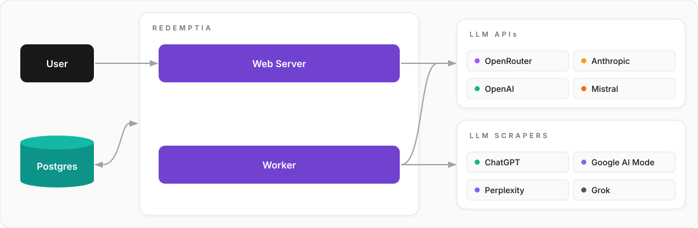

<p align="center">
  <a href="https://github.com/redemptia/redemptia">
    
  </a>
</p>

<p align="center">
  Open-source AI visibility tracking: how AI answer engines mention, rank and describe your brand.
</p>

## About

Redemptia runs the questions your customers ask AI assistants — ChatGPT, Google AI Overviews and AI Mode, Gemini, Perplexity, Copilot, Claude and others — on a schedule, stores every answer, and measures how those answers treat your brand and your competitors. The practice is known as Answer Engine Optimization (AEO) or Generative Engine Optimization (GEO).

It is self-hosted and MIT-licensed: the answers, the cited sources and every metric live in a PostgreSQL database you control, and the code that computes each number is in this repository.

Redemptia started as a clone of [elmohq/elmo](https://github.com/elmohq/elmo) and is developed independently; [UPSTREAM.md](UPSTREAM.md) records where and why it has diverged.

## What it measures

- **Visibility** — how often each engine's answers mention your brand, per prompt, per model and over time.
- **Share of voice** — your mention rate against each tracked competitor.
- **Prominence and rank** — how early an answer names you, and in what order among the brands it names, computed from the stored answer text.
- **Sentiment** — a model judges how each answer treats every brand it names: recommended, neutral, mentioned with caveats, advised against, or used as the foil for a competitor. The Sentiment page opens on the prompts whose answers set you back, each label shown with the answer's own words. Optional: it runs only with an analyzer key configured, and its spend is capped per organization per day.
- **Citations** — every URL an engine cites, by domain and category (your own, competitors', editorial, social).
- **Query fan-out** — the web searches an engine ran while grounding its answer.
- **Opportunities and reports** — a prioritized list of what to publish or pitch, and shareable visibility reports.

Every figure is available in the dashboard, over the REST API and through an MCP server.

## How it measures

1. Prompts are defined per brand, written by hand or suggested by the onboarding wizard from your website.
2. A worker runs each prompt on a schedule against every engine you configure — scraping providers for the consumer surfaces, direct model APIs for the rest.
3. Each answer's text, citations and web searches are stored, then scanned for your brand's and each competitor's names, aliases and domains.
4. Metrics are aggregated from what is stored, so any number can be recomputed and audited. Runs without answer text, and mentions not yet judged, are counted apart rather than as zero.

## Running it

The CLI isn't published under its new name yet, so for now Redemptia runs from source. You need Node.js 24, pnpm and PostgreSQL:

```bash
git clone https://github.com/redemptia/redemptia.git
cd redemptia
pnpm install
```

Then follow the [development setup](packages/docs/content/docs/developer-guide/development-setup.mdx) to create the database and `.env` files and start the web app and worker. `SCRAPE_TARGETS=stub:stub` runs everything without provider keys.

Once `@redemptia/cli` is on npm, `redemptia init` will set up a Docker Compose deployment interactively.

## Documentation

- [Getting started](packages/docs/content/docs/getting-started.mdx)
- [User guide](packages/docs/content/docs/user-guide/index.mdx) — brand setup, prompts, visibility, citations and reports
- [Providers](packages/docs/content/docs/user-guide/providers.mdx) — choosing scrapers and model APIs for each engine
- [Configuration](packages/docs/content/docs/developer-guide/configuration.mdx) — every environment variable
- [Architecture](packages/docs/content/docs/developer-guide/architecture.mdx)
- [REST API](packages/docs/content/docs/api/index.mdx) and [MCP server](packages/docs/content/docs/api/mcp.mdx)

## Architecture

<p align="center">
  
</p>

A web app serves the dashboard, REST API and MCP server; a worker schedules prompt runs and enrichment jobs on pg-boss; PostgreSQL holds both the data and the job queue. The stack is TypeScript, TanStack Start, Drizzle and pg-boss in a pnpm and Turborepo monorepo.

## Contributing and security

See [CONTRIBUTING.md](CONTRIBUTING.md). Report bugs and request features in [GitHub issues](https://github.com/redemptia/redemptia/issues); report vulnerabilities privately as described in [SECURITY.md](SECURITY.md).

## License

[MIT](LICENSE.md). The copyright notice of the original elmo code is kept alongside Redemptia's, as the license requires.
